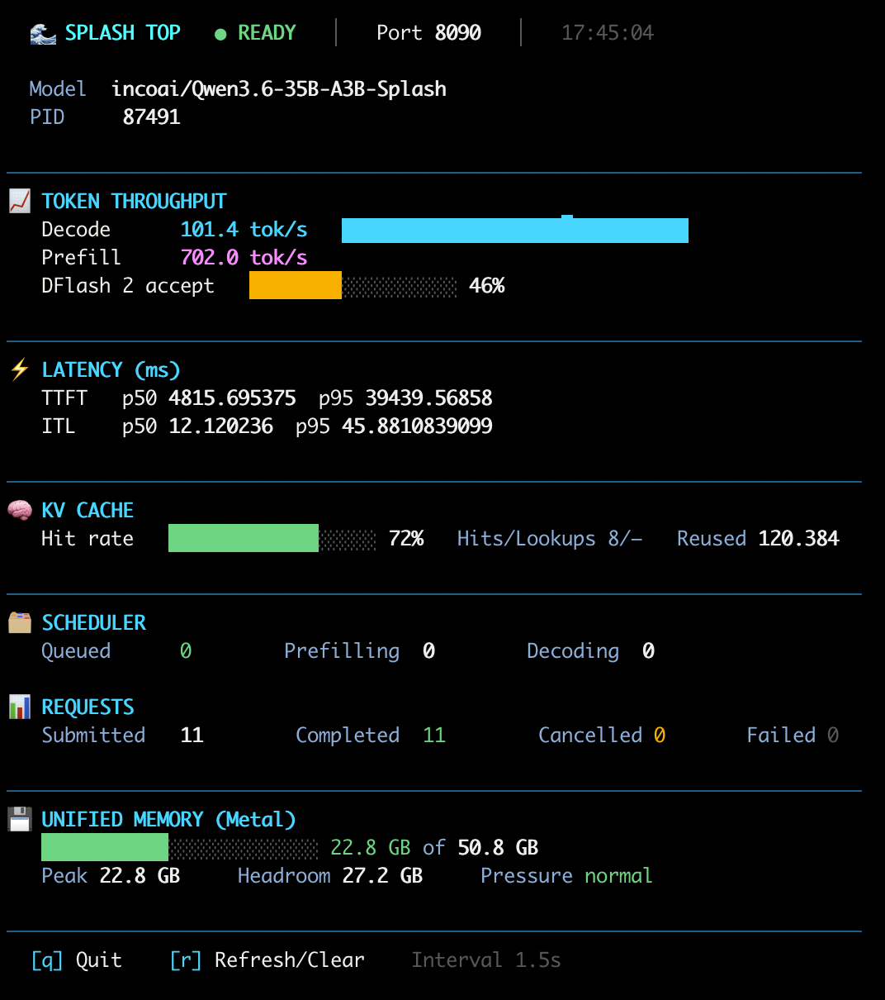

# splash-top.sh

A colorful, `htop`-style terminal monitor for [Inco AI's Splash](https://github.com/incoai/splash) local inference engine.

It polls `GET http://127.0.0.1:<port>/status` (with an optional API key) and renders the metrics formatted, colorized and live-updating.

Inspired by [SplashMonitor](https://github.com/hometrix/SplashMonitor) (Swift) — reimplemented as a lightweight bash/curl script.



## Requirements

- **Splash** running locally (see [incoai/splash](https://github.com/incoai/splash))
- `bash`, `curl`, `jq`

Install the dependencies with Homebrew:

```bash
brew install bash curl jq
```

## Usage

```bash
chmod +x splash-top.sh
./splash-top.sh -p 8090 -k YourSplashApiKey
```

Example commands:

```bash
./splash-top.sh              # Auto-detect port, live (htop-style)
./splash-top.sh -p 8090      # Force a specific port
./splash-top.sh -k KEY       # Splash API key (otherwise $SPLASH_API_KEY)
./splash-top.sh -i 0.5       # Poll interval in seconds (default 1.5)
./splash-top.sh -1           # Print once instead of a live loop
./splash-top.sh -N           # Disable colors
./splash-top.sh -v           # Debug output for port/auth detection
```

| Flag | Description |
|------|-------------|
| `-p PORT` | Force a specific port (instead of auto-detection) |
| `-i SEC` | Poll interval in seconds (default `1.5`) |
| `-k KEY` | Splash API key (otherwise `$SPLASH_API_KEY`) |
| `-1` | Print once instead of a live loop |
| `-N` | Disable colors |
| `-v` | Debug output for port/auth detection |

Port auto-detection checks, in order: the last-known port, the Splash `serve.lock` file, any running `splash serve` process (via `lsof`), and a list of fallback ports.

While running: `q` quits, `r` refreshes/clears the screen.

## Development

Screenshot and license are coming soon.

## License

MIT
